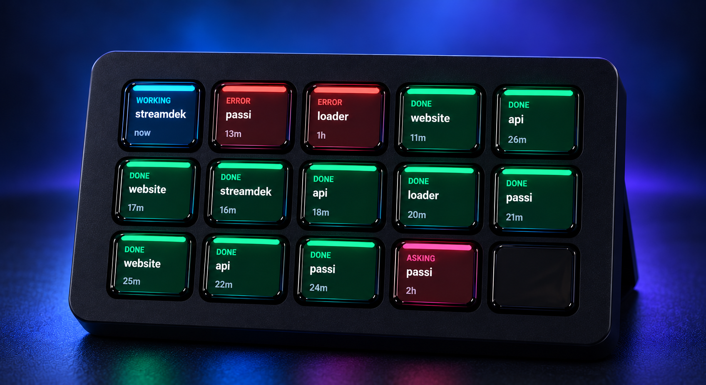

# Streamdek Agent Status

Show live Codex and Claude Code sessions plus active Codex scheduled automations on an Elgato Stream Deck, Android phone, or any web browser. Press a card to reopen its task on the desktop.

Supports Windows, macOS, and Linux without the Elgato desktop application. Android and browser displays connect directly over local Wi-Fi.

## Cards

- Pink `ASKING`: waiting for an answer.
- Blue `WORKING`: an agent or automation is running.
- Red `ERROR`: the latest run failed.
- Purple `SCHEDULED`: an enabled automation.
- Orange `UPDATE`: a newer Streamdek release is available.
- Green `DONE`: a recently completed task.
- Gray `IDLE`: a recent task without a recorded run.

Ordinary tasks disappear after 24 hours without activity. Active automations stay visible.
Codex and Claude Code cards show the working-folder name, falling back to the saved session name. Claude cards include a `CLAUDE` footer and reopen in a new terminal with `claude --resume`. Scheduled-task runs are grouped into one card per routine; its status and click target follow the most recent run.
Session cards show a compact excerpt from the latest agent response on the line below the name. Working and asking cards retain their button position while they remain active, so response updates do not make them jump around.

Session cards are ordered by latest activity, independent of status, so finishing a task changes its color without sending it behind older errors. Active scheduled automations occupy reserved buttons at the end, ordered by their next run.

Streamdek checks its public GitHub release feed at startup and at most once every six hours. When a newer version is available, an `UPDATE` card reserves one button without displacing scheduled automations. Press it to open the release and choose the installer for this computer.

## Requirements

- ChatGPT desktop with Codex, Claude Code, or both.
- A connected Elgato Stream Deck, an Android 8+ phone, a web browser on the same Wi-Fi network, or any combination.
- Claude Code must be available as `claude` on `PATH` to reopen Claude sessions.

The Linux ChatGPT app is currently a preview supported on Ubuntu 24.04/26.04, Debian 13, Fedora 43/44, and current Arch Linux. Other systemd desktops may run Streamdek, but are not formally supported by OpenAI.

Quit the Elgato Stream Deck application if it is installed because only one application can control the device directly.

## Android Wi-Fi display

Install `streamdek-*-android.apk` from the latest release. Keep the desktop and phone on the same trusted private Wi-Fi network.

1. Start Streamdek on the desktop.
2. Open the Android app and allow local-network access when requested.
3. Select a discovered desktop and press **Request access**. If discovery is unavailable, enter the desktop IP and port, such as `192.168.1.20:8910`.
4. Approve the notification and local approval page that opens on the desktop.

The app reconnects automatically and stores only the server address and granted random token. Tapping a card asks the desktop to open that Codex or Claude session. Windows may show a firewall prompt the first time; allow access on private networks.

Wi-Fi transport is authenticated but not encrypted. Do not expose port `8910` to the internet or use it on an untrusted network.

## Web display

On any phone, tablet, computer, or second screen on the same trusted network, open `http://DESKTOP-IP:8910`, such as `http://192.168.1.20:8910`. Name the screen and request access. Streamdek shows a desktop notification and opens a local approval page on the computer; approve it there once. The browser stores the granted token locally, reconnects automatically, shows the same live cards and colors, and opens a task on the desktop when tapped.

Press `AUTO` on a Codex or Claude session card to let that browser automatically answer approval requests for that session. The setting is stored only in that browser and applies to every request in the selected session, including tool and permission prompts. Enable it only for trusted, reversible work.

No app installation is needed. Keep the Streamdek desktop service running, and allow port `8910` through the desktop firewall on private networks.

## Install

Download the native installer for your operating system from the [latest release](https://github.com/jetcar/streamdek/releases/latest). Node.js and production dependencies are included.

| Platform | Installer |
|---|---|
| Windows | Run `streamdek-*-windows-x64-setup.exe` |
| macOS Apple silicon | Open `streamdek-*-macos-arm64.pkg` |
| macOS Intel | Open `streamdek-*-macos-x64.pkg` |
| Debian/Ubuntu x64 | Install `streamdek-*-linux-x64.deb` |
| Debian/Ubuntu ARM64 | Install `streamdek-*-linux-arm64.deb` |
| Android 8+ | Install `streamdek-*-android.apk` |

The desktop installers are currently unsigned, so the operating system may ask you to confirm the download. The Android APK is signed. The Linux package adds the upstream desktop-user udev permissions. Unplug and reconnect the Stream Deck once after the first installation.

Desktop installations start automatically after login and relaunch Streamdek after an unexpected process exit.

To install from source instead, clone the repository and run `scripts/install.ps1`, `scripts/install-macos.sh`, or `scripts/install-linux.sh`. Source installation requires Node.js 24 or newer.

## Uninstall

| Platform | Stop and remove startup |
|---|---|
| Windows | Windows Settings → Apps → Streamdek |
| macOS | `sudo "/Library/Application Support/Streamdek/uninstall.sh"` |
| Linux | `sudo apt remove streamdek` |

## Logs

| Platform | Location |
|---|---|
| Windows | `%LOCALAPPDATA%\streamdek\streamdek.log` |
| macOS | `~/Library/Application Support/streamdek/streamdek.log` |
| Linux | `${XDG_STATE_HOME:-~/.local/state}/streamdek/streamdek.log` |

Optional environment variables:

- `STREAMDEK_STALE_HOURS` — task expiry, default `24`.
- `STREAMDEK_POLL_MS` — refresh interval, default `2000`.
- `STREAMDEK_WIFI_PORT` — Android and web display server port, default `8910`.
- `STREAMDEK_STATE_DIR` — absolute directory for logs and the process file.
- `CODEX_HOME` — Codex state directory, default `~/.codex`.
- `CLAUDE_CONFIG_DIR` — Claude Code state directory, default `~/.claude`.

The service reads Codex databases and Claude Code transcripts in read-only mode and controls the Stream Deck directly. Codex links use the operating system URL opener. Claude sessions open in Command Prompt on Windows, Terminal on macOS, and `x-terminal-emulator` on Linux.

## Development

Run `npm test`, `npm run typecheck`, and `npm run build` for the desktop service. Run `cd android` and `./gradlew testDebugUnitTest assembleDebug` for Android.

## References

- [ChatGPT desktop deep links](https://learn.chatgpt.com/docs/reference/commands#deep-links)
- [ChatGPT desktop app for Linux](https://learn.chatgpt.com/docs/linux/linux-app)
- [Claude Code CLI session resume](https://code.claude.com/docs/en/cli-reference)
- [Stream Deck Node library and Linux permissions](https://github.com/Julusian/node-elgato-stream-deck/tree/main/packages/node)
- [XDG Base Directory specification](https://specifications.freedesktop.org/basedir/)
- [systemd service units](https://www.freedesktop.org/software/systemd/man/latest/systemd.service.html)
- [Apple LaunchAgents](https://developer.apple.com/library/archive/documentation/MacOSX/Conceptual/BPSystemStartup/Chapters/CreatingLaunchdJobs.html)
